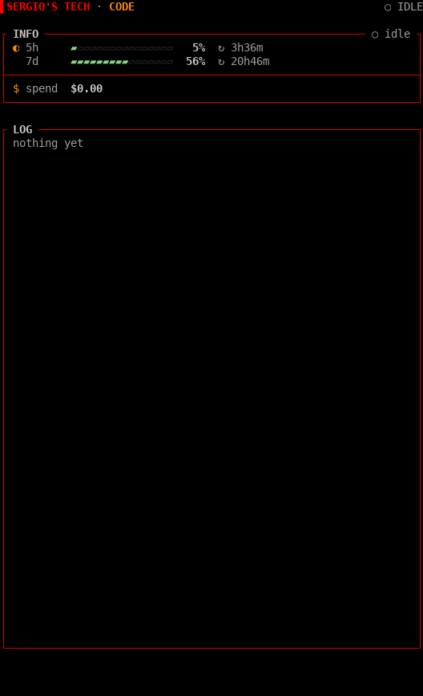
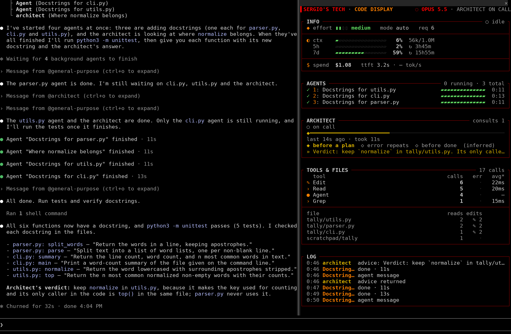
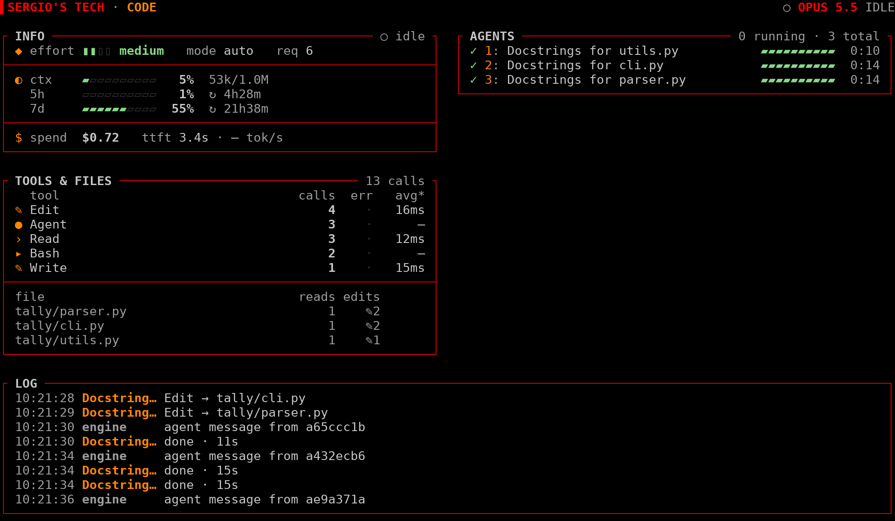
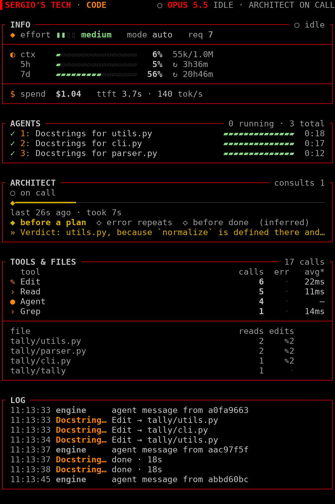
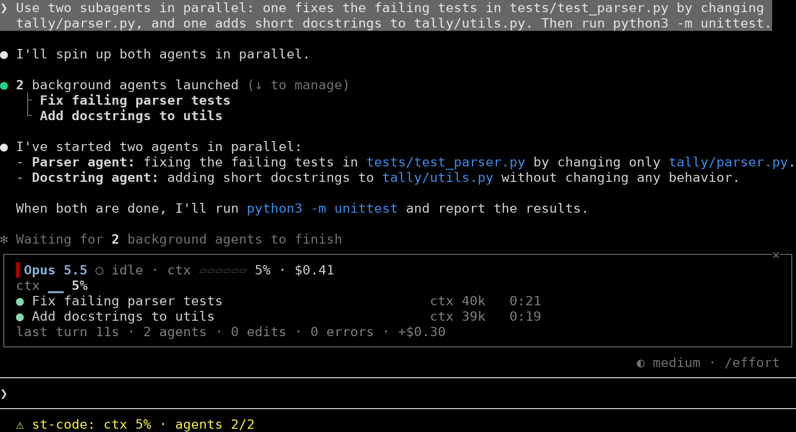

# Sergio's Tech · Code

[](https://github.com/sergios-tech/code-dashboard/releases/latest)
[](LICENSE)
[](#install)

**A live, read-only session dashboard for Claude Code.** It opens a pane beside the transcript that
shows what the session is doing right now: the main model's INFO, subagents at work, architect
consults, the busiest tools and files, how context and cost trend, and a session log. Every number comes from a real session event, anything inferred says so, and nothing leaves
your machine.

<p align="center">
  
</p>

<p align="center">
  <a href="#install">Install</a> · <a href="#what-you-see">What you see</a> · <a href="#use">Use</a> · <a href="#where-it-runs">Where it runs</a> · <a href="#what-it-can-reach">What it can reach</a> · <a href="#configure">Configure</a> · <a href="#troubleshooting">Troubleshooting</a> · <a href="CHANGELOG.md">Changelog</a>
</p>

## Install

Inside Claude Code 2.1.300 or later:

```
/plugin marketplace add sergios-tech/code-dashboard
/plugin install st-code@sergios-tech
/reload-plugins
/st-code
```

From a terminal:

```sh
claude plugin marketplace add sergios-tech/code-dashboard
claude plugin install st-code@sergios-tech
```

Or load it from a clone for one session:

```sh
git clone https://github.com/sergios-tech/code-dashboard
claude --plugin-dir ./code-dashboard
```

If the installer lists options as unset, the defaults apply. You can change them in
[`/config`](#configure).

The hooks API this plugin is built on is an early-access part of Claude Code and can change between
releases. If something breaks after an update, see [Troubleshooting](#troubleshooting).

## What you see

<p align="center">
  
</p>

| Two columns, in a 120-column dock | One column, in the default 66-column dock |
| --- | --- |
|  |  |

<p align="center">
  
</p>

The header is one unfilled row on black. `▌SERGIO'S TECH · CODE` sits on the left. On the right are
the state dot, the main model in its family colour (Opus red, Sonnet orange, Haiku green, Fable gold,
any other model grey) and dim state words, for example `● OPUS 5.5 WORKING` or `○ OPUS 5.5 IDLE`.
Once an architect has been seen, `· ARCHITECT ADVISING` or `· ARCHITECT ON CALL` joins it. The dot is
green and pulses while a turn or a subagent is running, and the words follow the main loop alone, so
background agents after a turn read `● HAIKU 5.5 IDLE`. A frame turns green while its panel holds
running work: INFO while the main loop works, AGENTS while an agent runs, ARCHITECT while the
architect advises.

Panels with nothing to show take no room, so a fresh session shows the header, INFO and LOG.

| Panel | Shows | From |
| --- | --- | --- |
| **INFO** | Three groups split by dividers. Model: the effort gauge (`◆ effort ▮▮▮▮ xhigh`), `mode auto` and `req 7`. Usage: a context gauge with tokens/window and compactions (`↺1`), then each of the first two rate-limit windows on its own row with its reset countdown (`↻ 3h51m`). Spend: the session cost and the last main-loop request's `ttft` and `tok/s`. Gauges are green, gold from 80% and coral from 90%. `mode bypass` shows in coral. A group with no data is left out, and with none at all the panel reads `waiting for the first request`. | `turn.step`, `classic.UserPromptSubmit`, `session.measure`, `session.compact`, `$.session.usage()` |
| **TRENDS** | A table of two rows, context fill and cumulative cost, each a sparkline across the session with the current figure and its change since the reading before (`+2`, `+$0.02`). The ctx cells take the level colours, so a session running hot shows where it crossed, and the cost line is drawn in a quiet grey. A gold `↺` marks the reading where a compaction landed, on both lines. The change column drops when the frame is under 50 columns inside. Appears from the second reading; when the host reports no cost, only the ctx line shows. | `session.measure` readings that change context or cost, the start-of-session reading, `session.compact` |
| **AGENTS** | One row per agent, running agents first and the newest first among them. Each row has a status glyph, its hotkey digit and title, the model when it differs from the main one, a status bar and a clock. The bar is a 3-cell block that bounces along the track while the agent runs, and fills green, coral or grey once it is done, failed or stopped; it shows that an agent is alive, not how far along it is. A request cut at `max_tokens` shows as failed. Six rows show, hotkeys `1`–`6`, under a `+N earlier` row. The frame meta reads `N running · N total`. An opened agent shows inside the frame after a divider. The last row is `loops  2 seen · 1 active` with one dot per model loop that no agent claims (workflow agents, compactions, forks): `●` active, `✓` done, `○` idle. It shows only while AGENTS does. | `agent.spawn`, `turn.step`, `tool.call`, `turn.complete` |
| **ARCHITECT** | `● advising` or `○ on call`. Consults on a one-row timeline (`◆` where one started, `━` while it ran). When the last one ran and how long it took. The inferred moment of the last consult. A `»` line with the first line of the advice. The frame is green while it advises. | `agent.offer`, `agent.spawn` of a matching type, matching server tools in `session.append`, `turn.complete`, the `SubagentHandback` call or hand-back turn |
| **TOOLS & FILES** | A table of the busiest tools (4 rows, 6 in two columns): a glyph for the tool's family (`›` read, `✎` edit, `▸` run, `●` agent, `·` other), the name (an MCP tool as `server:tool`), calls, errors (`✗3`) and the average time per call under `avg*`. After a divider, the 5 paths touched most, each with reads and edits (`✎2`). Paths show their last two segments, and a file that only subagents touched is dimmed. | `tool.call`, `tool.check` |
| **LOG** | Prompts (first 70 characters), spawns, completions, consults and advice, edits, errors, denials, compactions and `max_tokens` hits. Each line has an `HH:MM:SS` time, an actor (`opus` for the main loop, named by its model, then `you`, an agent such as `Explore 1`, or `architect`) and its text. Only the mark after the text carries a state: `✗` in coral, `· denied` in gold. It takes the rows the other panels leave, up to 8. A pane too short for 2 hides it rather than cutting it off at the bottom edge. | all of the above |
| **Status line** | `ctx 51% ↺1 · agents 2/3 · architect advising · denied 1`. Each field appears only when it has something to say. With no consult open, the architect field shows the consult count. | the same state |

A **denial** is a call refused by a permission rule or hook. It writes one log line that ends with a
gold `· denied` (`Bash → rm -rf build · denied`) and adds to `denied N` in the status line. Declining an approval prompt
is not a denial: that call counts as a failed call (`✗`) in TOOLS & FILES and the log.

## Use

| Command | Does |
| --- | --- |
| `/st-code` (or `/st-code open`) | Opens the pane. |
| `/st-code close` | Closes it. |
| `/st-code reset` | Clears agents and loops, consults, tools and files, the denial count, the log and any `/st-code layout` choice. The model, permission mode, session cost, rate limits, compaction count and trend lines stay. The context gauge returns with the next reading. |
| `/st-code layout auto\|compact\|wide\|mini` | Picks the layout for this session, overriding the `layout` option. |

`/clear` resets the pane the same way as `/st-code reset`.

Focus the pane with `ctrl+x tab`, then:

| Key | Does |
| --- | --- |
| `1` to `6` | Opens that row's agent inside the AGENTS frame: the full task, its type, model, status and steps, its last 3 tool calls and the start of its answer. Press the key again to close it. The digits follow the drawn order, so they shift when an agent finishes. |

While you view a subagent's transcript, its row is marked `▶` and the log shows only that
agent's lines (`LOG · THIS AGENT`).

## Where it runs

- **Fullscreen terminal, 110 columns or wider:** the pane docks beside the transcript. The dock opens
  66 columns wide, which draws one column.
- **Main screen, or a terminal under 110 columns:** the pane sits inline above the prompt and, under
  `auto`, draws a summary of at most 8 rows on black, without frames. The rows are the state and a
  digest of INFO's figures, the ctx trend (from two readings), up to five agents (six without the
  trend row), running ones first, and a last row for the agents left out and the loops. It takes no
  keys, so its agent rows carry no digit.
- **Desktop app and VS Code:** the same design, drawn as pictures. Each block (the header, each panel
  or the two columns together, and the log) is one SVG laid out cell for cell as the terminal would
  show it, on black. The header pulse and the AGENTS sweep animate on both, and both show each clock
  as it stood at the last redraw. The agents' time axis stays under AGENTS. The digit keys still open
  an agent, but a picture's text can't be selected and its rows can't be clicked.

**Two columns.** Under `auto`, the wide layout starts at a dock of 110 columns. The host caps the
dock at 45% of the terminal's width and opens it at 66 columns, so you need both of these:

- A terminal at least 245 columns wide.
- A dock widened to 110 columns or more. Drag it wider; the host remembers the width you set.

`/st-code layout wide` draws two columns from a dock of 82 columns: a terminal at least 183 columns
wide, with the dock widened. Below 82 it stays in one column. `/st-code layout compact` keeps one
column at any width. `/st-code layout mini` draws the 8-row summary even when docked.
`/st-code layout auto` goes back to choosing by width.

**Opening by itself.** With `openOnStart`, the plugin opens the pane when a session starts. The host
only places a pane opened that way in a terminal at least 144 columns wide, or 110 once you have
opened the pane yourself and not closed it by hand. Below that, run `/st-code`, which opens it at any
width.

**Colours.** The palette is fixed: the Signal palette on a pure black fill, made for black or dark
terminals. It doesn't follow your terminal or host theme, and there's no light variant. Green is the
working colour, gauges go green to gold to coral, agents are orange and frames are red. Every text
colour reaches at least 4.5:1 contrast on black, and so does its 256-colour fallback. Frame lines and
the empty cells of gauges and bars never carry text. A state never relies on colour alone: `●`
running, `✓` done, `✗` failed, `■` stopped, `↺` compaction, and a refused call says `denied`.

## What it can reach

The plugin only watches. Every hook passes its event on unchanged: it never denies, rewrites or
blocks a tool call, a prompt or a subagent.

| It sees | Through |
| --- | --- |
| Every tool call's name and input, whether it failed, and how long it took | `tool.call` |
| Each call's permission verdict, used only to tell an approval prompt or a refusal apart | `tool.check` |
| The agent types offered to the model, used to remember which ones are the architect | `agent.offer` |
| Subagent spawns, their model requests and token usage, and their final answers | `agent.spawn`, `turn.step`, `turn.complete` |
| The main loop's requests: model, effort, timing and output tokens | `turn.step` |
| The opening text of each main-loop turn (your prompt, first 70 characters, for the log) and the permission mode | `turn.start`, `classic.UserPromptSubmit` |
| Context, cost and rate-limit readings, and compactions | `session.measure`, `session.compact`, `$.session.usage()` |
| The main loop's replies, read only for server-side advisor calls (whose content stays encrypted) | `session.append` |
| An architect agent's hand-back report | the `SubagentHandback` tool call |

What it keeps, in session state: a tool call as its name plus a command, a path cut to its last two
segments, a pattern, a URL or a description; your prompts' first 70 characters; agent tasks and the
start of their answers; the first line of the architect's advice. Credentials are masked before
anything is stored. The lists are capped: 24 agents, 60 other loops, 60 log lines, 40
consults, 40 tools, 200 files and 60 trend samples.

What it never does: it makes no network requests, runs no processes, reads and writes no files,
calls no model and stores nothing across sessions. `claude plugin validate .` prints every hook it
registers and every host call it makes.

## What is inferred, not measured

- **Architect moments.** "Before a plan" means nothing has been edited yet this turn. "Error repeats"
  means 2 or more main-loop errors in a row. "Before done" means edits were made this turn. The
  panel labels them `(inferred)`, and `moments: false` turns them off.
- **Server-side advice is encrypted.** When the architect is a server tool, the pane counts and times
  the consult and logs `advice returned`, but cannot show what the tool said. The `»` advice line
  comes only from an architect agent's answer or hand-back.
- **Per-agent `ctx` is the latest request's whole input** (uncached, cache read and cache write). It
  is labelled `ctx`, not cost, because there is no per-agent cost to report.
- **Other loops** can't tell a workflow agent from a compaction or a fork. All of them are model loops
  that no agent row claims.
- **A background agent's first step** can arrive before its row exists, so its row may count one
  step late.
- **Request speed.** `ttft` and `tok/s` are timed at st-code's own `turn.step` hook, so they include
  everything beneath it: other plugins' hooks, the engine, the network and any retry. `tok/s` divides
  the reported `output_tokens` (thinking included) by the time from the response's first chunk to the
  stop. A response that arrives in one burst can't be timed and reads `— tok/s`. They are measured, but they aren't the API's own figures.
- **`avg*` in TOOLS & FILES.** The clock is read before and after the rest of the tool call runs, so
  the time includes other plugins' hook time on that call. Some calls are left out of the average
  because they would time something other than the tool: calls whose permission check asked for
  approval, denied calls and `Agent` calls, which run a subagent to its end. These calls still count
  toward calls and errors.
- **Trends thinning.** Past 60 readings, the session's first reading stays and the rest pair up. Each
  pair keeps the later reading, plus a `↺` if either had one. The lines still span the whole
  session, but a short spike between two kept readings can drop out.

## Configure

In `/config`, or under `pluginConfigs["st-code"].options` in `settings.json`. Reads are lenient: a
malformed value falls back to its default.

| Option | Default | Meaning |
| --- | --- | --- |
| `architectPattern` | `advisor\|architect` | Case-insensitive regex for architect agent types and server tools |
| `matchDescriptions` | `false` | Also match agent descriptions |
| `architectLabel` | `ARCHITECT` | Label for the architect role |
| `panels` | `info,trends,agents,architect,tools,log` | Which panels show, in order (compact layout) |
| `layout` | `auto` | `auto`, `compact`, `wide` or `mini` |
| `motion` | `on` | `on` or `off` |
| `moments` | `true` | Show the inferred consult moments |
| `openOnStart` | `true` | Open the pane at session start, in terminals ≥ 144 columns |
| `statusLine` | `true` | Status line fields |

`motion: off` stops the header pulse and the AGENTS sweep, but the clocks keep ticking. The wide layout
puts INFO, TRENDS and TOOLS & FILES in the left column and AGENTS and ARCHITECT in the right, with
the LOG underneath. There, `panels` still hides panels and sets the order inside each column.

## Troubleshooting

**The pane doesn't appear.**
- Check that `claude --version` reports 2.1.300 or later, then run `/reload-plugins` and `/st-code`.
- When the host can't place the pane, `/st-code` replies `The dashboard is not shown yet:` followed by
  the host's reason.
- At session start the pane only opens by itself in terminals at least 144 columns wide. Run
  `/st-code` to open it at any width.
- Look in the transcript for a dim line starting `st-code:`. It names the hook that failed or the
  reason the pane was refused. Please
  [open an issue](https://github.com/sergios-tech/code-dashboard/issues) and include it.

**It stays in one column.** The dock opens at 66 columns. See [Two columns](#where-it-runs).

**The colours look wrong.** The palette is fixed and made for a black background. Under tmux the host
draws 256 colours unless `CLAUDE_CODE_TMUX_TRUECOLOR=1` is set, and VS Code's integrated terminal is
capped at 256. In 256 colours, orange draws as `#ff8700` and the reds and greens shift slightly. Every
text colour still reaches 4.5:1 contrast.

**There's too much motion.** Set `motion` to `off`.

**The counters look stale after an update.** Run `/st-code reset`. Stored state is always read
leniently, and state saved under an older schema is rewritten when a session starts.

## Credits

Derived from [Flightdeck](https://github.com/scasella/claude-flightdeck) by Stephen Casella, under the
MIT license. Flightdeck proved the idea and the event-to-reducer approach. st-code is a rewrite with
its own panels, layouts and look. Both copyright notices are in [LICENSE](LICENSE).

Screenshots and the demo are captured from a real session with the scripts in
[`scripts/capture/`](scripts/capture/README.md). The social preview card is
[`docs/media/social-preview.png`](docs/media/social-preview.png).

Contributing: [CONTRIBUTING.md](CONTRIBUTING.md) · Security: [SECURITY.md](SECURITY.md) · License:
[MIT](LICENSE)

---

Made by Sergio Jovanotti at [Sergio's Tech](https://www.sergios.tech).
